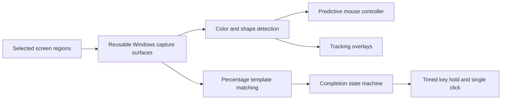

# Fishing Helper

A Windows desktop application that uses computer vision to track a fishing minigame, control mouse input, and run a configurable pickup sequence.

Built with **Python, Tkinter, NumPy, Pillow, and the Windows API**. This portfolio project explores real-time visual feedback, lightweight text recognition, input automation, and performance tuning.

## Features

- Selectable screen regions for the fishing bar and progress percentage.
- Color-based detection of green/yellow targets and the white moving dot.
- Cyan and orange overlay lines showing the detected dot and target positions.
- Predictive control with a dead zone to reduce overshooting.
- Local percentage recognition using font templates and vectorized comparisons.
- Saved sliders for completion threshold, wait time, T hold time, and click duration.
- Live tracking FPS, F8 start/stop, F9 emergency stop, and foreground-window checks.

## Quick start

Requires **Windows 10/11 and Python 3.11+ with Tkinter**. Percentage recognition uses standard Windows fonts. Use the primary monitor.

```powershell
py -3 -m venv .venv
.venv\Scripts\python.exe -m pip install -r requirements.txt
.venv\Scripts\python.exe app.py
```

Alternatively, double-click `Start.bat` in File Explorer. In VS Code, use the terminal commands above; F5 on a batch file is not the launch method.

## Using the app

1. Start fishing manually so the vertical bar and percentage are visible.
2. Select the entire fishing bar, including its target and dot.
3. Select only the bottom number and `%` symbol; exclude Exit.
4. Press **F8**, then focus the game and position the pointer over it within two seconds.
5. Press **F9** to stop.

The **cyan line** follows the dot; the **orange line** marks the target center. The status shows whether the mouse is held or released. Reverse the UP checkbox if holding the mouse moves the dot down. Reselect areas after moving the game or changing resolution.

### Finish sequence

Two consecutive valid readings at or above the selected threshold trigger pickup. Defaults:

**98% → release mouse → wait 1.5 seconds → hold T for 3.5 seconds → release T → click once.**

Open **Customize finish sequence** to adjust:

| Setting | Range | Default |
| --- | --- | --- |
| Completion threshold | 50–100% | 98% |
| Wait before T | 0–10 seconds | 1.5 seconds |
| T hold duration | 0.1–10 seconds | 3.5 seconds |
| Final click duration | 0.05–2 seconds | 0.1 seconds |

Settings save to `settings.json`, which is excluded from version control. Timings are captured at pickup start, so slider changes affect the next pickup. The initial casting hold is configured separately.

Lost tracking or an unreadable percentage alone never counts as completion. A separately selected Collect prompt can confirm pickup after a tracked catch. After pickup, progress must fall below the threshold minus three percentage points to arm pickup again. Losing focus during a T hold releases input and stops the sequence.

## Architecture



| File | Responsibility |
| --- | --- |
| `app.py` | Tkinter UI, detection, overlays, scheduling, and state transitions |
| `capture.py` | Region-only GDI capture with reusable buffers |
| `control.py` | Velocity prediction and input hysteresis |
| `progress.py` | Local percentage glyph matching |
| `keyboard_input.py` | Windows scan-code key transitions |
| `tests/` | Detection, control, percentage, and pickup regression tests |

The tracking loop targets 60 updates per second. Percentage recognition runs on a separate 50 ms schedule within the same event loop. Status text updates less frequently than mouse control and tracking lines.

## Performance work

For a 130 × 800 region, local development measurements showed median capture time decreasing from approximately **69 ms with Pillow screen capture to 7 ms with reusable region-only Windows capture**. Vectorized percentage matching decreased from approximately **3.3 ms to 1.0 ms**.

These are measurements from one development machine, not a cross-device benchmark. Actual gameplay FPS depends on hardware, game rendering, and selected regions. The app displays its measured tracking rate.

## Tests

```powershell
python -m unittest discover -s tests -v
```

The suite covers target colors, bottom-edge dot detection, empty-water rejection, controller direction and braking, percentage boundaries, completion confirmation, timing snapshots, and ordered key/mouse events. Input delivery is mocked; tests do not control a live game. GitHub Actions is configured for Windows with Python 3.11, 3.12, and 3.13.

## Limitations

- Tuned for the minigame colors and layout used during development; other themes need calibration.
- Percentage recognition can fail with occlusion, extra objects in the selection, or unfamiliar fonts.
- The foreground title check looks for Roblox; it cannot detect in-game chat or menus. Keep them closed while running.
- Windows reporting a held key does not guarantee the game interprets it as intended. Pickup timing needs live testing.
- Capture exclusion for overlays requires a supported Windows version.
- Independent project, not affiliated with Roblox. Use automation only where permitted.

## Development notes

Created through an **AI-assisted development workflow**, with hands-on gameplay testing and iterative feedback. Engineering lessons included reducing capture latency, diagnosing detection through overlays, separating lost tracking from completion, and making input timing observable and configurable.


### Diagnosing pickup (F7)

Press **F7** or **Test T hold only**, then focus Roblox within two seconds. This holds T for your configured duration without sending a casting click. **F9** still stops it. No screen regions need to be selected for this test.

Pickup now starts its timer only after Windows reports T as DOWN. If that state is lost, the app reasserts key-down without sending a key-up, resets the continuous hold timer, and allows at most two retries. If Windows never confirms the hold, pickup stops without casting. Focus loss also stops pickup. The display distinguishes waiting for confirmation from a confirmed hold; a confirmed Windows hold still needs validation against the game's behavior.

A small rotating `pickup.log` records completion triggers, key transitions, confirmation, retries, and focus interruptions. It stays local and is excluded from Git. This helps distinguish a missed percentage trigger from input trouble.


### Collect prompt backup

If the finishing percentage disappears before it is recognized, select **Select Collect word (backup)** while an item is waiting to be collected. Drag tightly around only the word **Collect**, excluding the item name, T circle, and surrounding outline. Keep the camera steady; reselect if the prompt moves. This selection is local to the current app session.

On subsequent catches, the backup runs after a fish has been tracked. When the bar is absent and Collect is recognized twice, it starts the same configured wait, verified T hold, and single click. Merely losing the bar never starts pickup. The Collect status shows FOUND or waiting. Percentage-based completion remains available, and either a percentage selection or a Collect selection can be used alongside the fishing bar. Collect recognition is font/template based and depends on a tight crop; it is not a general OCR engine.
